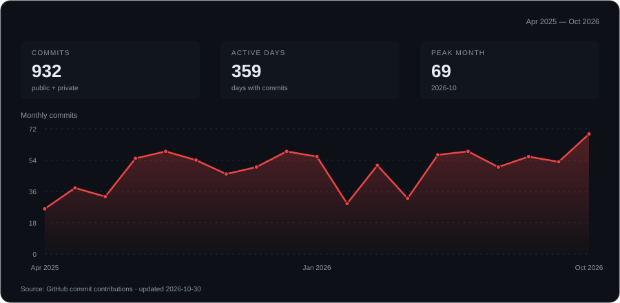

  

### About

Computer Engineering undergraduate at **BINUS University**. I work on embedded systems, desktop tools, and web applications.

### Core skills

  

- **Languages:** C++, Python, JavaScript, TypeScript
- **Web:** React
- **Hardware:** Arduino, serial communication, sensor data
- **Tools:** Git

### Projects

- **[SerialScope](https://github.com/Xeyzen7959/SerialScope)** — Arduino serial monitor with live sensor plots and data export.
- **[RelayDesk](https://github.com/Xeyzen7959/Relay-Desk)** — Customer-support demo with simulated AI answers, knowledge-base citations, and human handoff.
- **[ESPION](https://github.com/Xeyzen7959/ESPION)** — ESP-32 C++ based flipper zero alternative.
- **[Automatic AI Attendance Taker](https://github.com/Xeyzen7959/Automatic-Ai-Attendance-Taker)** — AI Facial Recognition Attendance system project.

### GitHub performance

<!-- contribution-graph-config
{
  "username": "Xeyzen7959",
  "start": "2023-01-01",
  "end": "today",
  "accent": "#ef4444",
  "includePrivate": true
}
-->

### Connect with me

