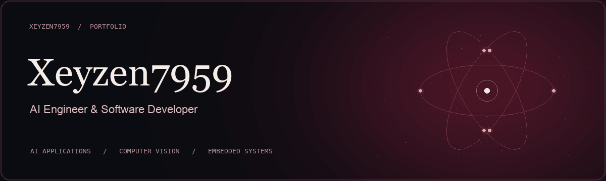
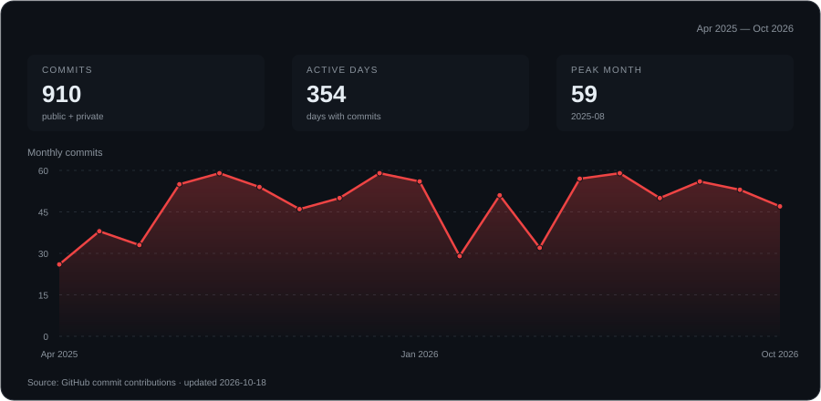

  

  <a href="#about">About</a> &nbsp;·&nbsp;
  <a href="#core-skills">Core skills</a> &nbsp;·&nbsp;
  <a href="#selected-projects">Projects</a> &nbsp;·&nbsp;
  <a href="#connect-with-me">Connect</a>

### About

**AI Engineer & Software Developer** studying Computer Engineering at **BINUS University**.

I build AI applications, computer vision projects, embedded systems, and tools for the web and desktop.

### Core skills

  

| Area | Skills |
| :--- | :--- |
| **Languages** | Python · C# · C++ · JavaScript · TypeScript |
| **AI engineering** | AI applications · Computer vision · Facial recognition |
| **Web & desktop** | React · Desktop tools · Data visualization |
| **Embedded systems** | Arduino · ESP32 · Serial communication · Sensors |
| **Version control** | Git · GitHub |

### Selected projects

<table>
<tr>
<td width="50%" valign="top">

**[Automatic AI Attendance Taker](https://github.com/Xeyzen7959/Automatic-Ai-Attendance-Taker)**

AI facial recognition attendance system.

`Computer vision` `C++`

</td>
<td width="50%" valign="top">

**[ESPION](https://github.com/Xeyzen7959/ESPION)**

ESP32-based alternative to the Flipper Zero.

`Embedded systems` `C++`

</td>
</tr>
<tr>
<td width="50%" valign="top">

**[SerialScope](https://github.com/Xeyzen7959/SerialScope)**

Arduino serial monitor with live sensor plots and data export.

`Python` `Data visualization`

</td>
<td width="50%" valign="top">

**[RelayDesk](https://github.com/Xeyzen7959/Relay-Desk)**

Customer-support demo with simulated AI answers, citations, and human handoff.

`React` `TypeScript`

</td>
</tr>
</table>

### Commit activity

<!-- contribution-graph-config
{
  "username": "Xeyzen7959",
  "start": "2025-04-16",
  "end": "today",
  "accent": "#ef4444",
  "includePrivate": true
}
-->

### Connect with me

