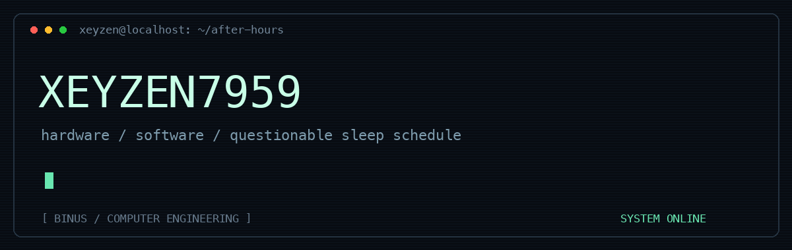

<p align="center">
  
</p>

<p align="center">
  <samp>computer engineering @ BINUS</samp>
</p>

<p align="center">
  <a href="https://github.com/Xeyzen7959?tab=repositories"></a>
  
</p>

---

### `01 / operator notes`

most of my ideas start with “what if” and end with too many open tabs.

i like making things i can actually use. sometimes that means a desktop tool. sometimes it means staring at a board and wondering why it stopped talking.

```text
location    :: somewhere between a breadboard and a terminal
focus       :: embedded systems / useful tools / interfaces
method      :: build → break → figure it out → repeat
```

### `02 / field work`

| project | what it does | tools |
| :--- | :--- | :--- |
| [**SerialScope**](https://github.com/Xeyzen7959/SerialScope) | arduino serial monitor, live sensor plots, and capture exports | `Python` |
| [**RelayDesk**](https://github.com/Xeyzen7959/Relay-Desk) | support platform demo with simulated AI answers, citations, and human handoff | `React` `TypeScript` |
| [**ESPION**](https://github.com/Xeyzen7959/ESPION) | one of my hardware-side experiments | `C++` |
| [**Automatic AI Attendance Taker**](https://github.com/Xeyzen7959/Automatic-Ai-Attendance-Taker) | attendance project, somewhere in the lab | `C++` |

### `03 / toolbox`

<p>
  
  
  
  
  
  
</p>

<details>
<summary><samp>open the maintenance log</samp></summary>

<br />

```text
[ OK ] idea acquired
[ OK ] project folder created
[WARN] scope has escaped containment
[....] making it work anyway
```

</details>

---

<p align="center"><samp>no grand manifesto. just things i'm building.</samp></p>
