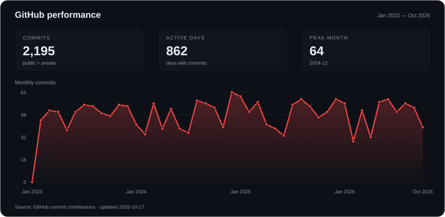

  

### About

Computer Engineering undergraduate at **BINUS University**. I work on embedded systems, desktop tools, and web applications.

### Core skills

  

- **Languages:** C++, Python, JavaScript, TypeScript
- **Web:** React
- **Hardware:** Arduino, serial communication, sensor data
- **Tools:** Git

### Projects

- **[SerialScope](https://github.com/Xeyzen7959/SerialScope)** — Arduino serial monitor with live sensor plots and data export.
- **[RelayDesk](https://github.com/Xeyzen7959/Relay-Desk)** — Customer-support demo with simulated AI answers, knowledge-base citations, and human handoff.
- **[ESPION](https://github.com/Xeyzen7959/ESPION)** — ESP-32 C++ based flipper zero alternative.
- **[Automatic AI Attendance Taker](https://github.com/Xeyzen7959/Automatic-Ai-Attendance-Taker)** — AI Facial Recognition Attendance system project.

### Contribution activity

<!-- contribution-graph-config
{
  "username": "Xeyzen7959",
  "start": "2023-01-01",
  "end": "today",
  "colors": ["#161b22", "#4c1720", "#852432", "#bf3545", "#f85149"]
}
-->

Customize this graph

Edit the `contribution-graph-config` block in this README's source:

- `start`: first date, in `YYYY-MM-DD` format.
- `end`: `today` for ongoing updates, or a fixed `YYYY-MM-DD` date.
- `colors`: five hex colors, from empty days to the busiest days.

The graph rebuilds when this README changes and refreshes daily. You can also run **Actions → Update contribution graph → Run workflow**. It shows the contribution counts visible on your GitHub profile, including anonymized private activity when GitHub makes it publicly available.

### Connect with me

